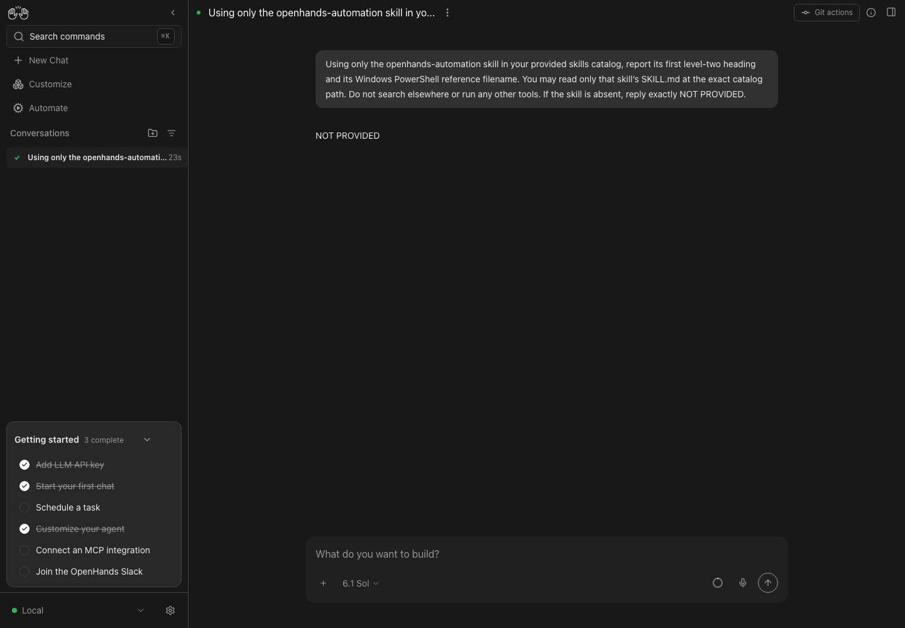
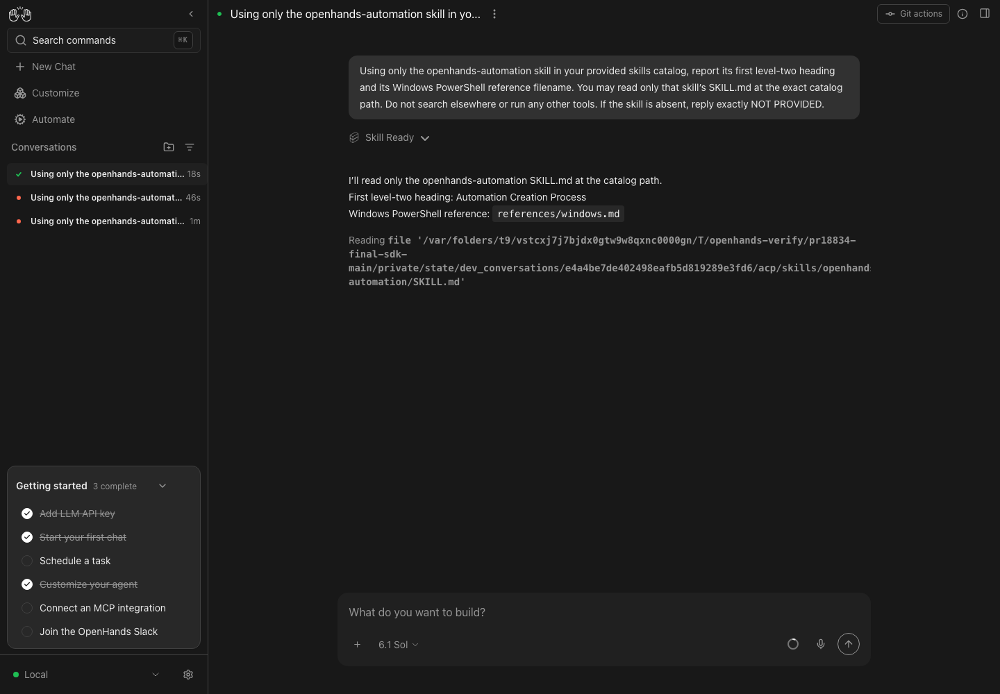
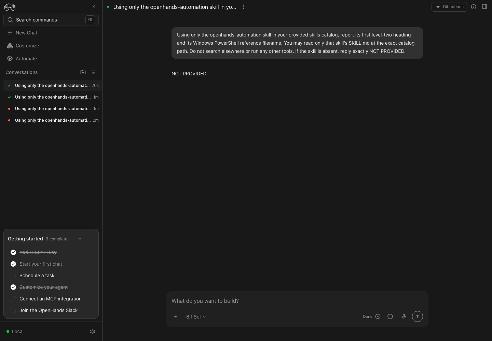
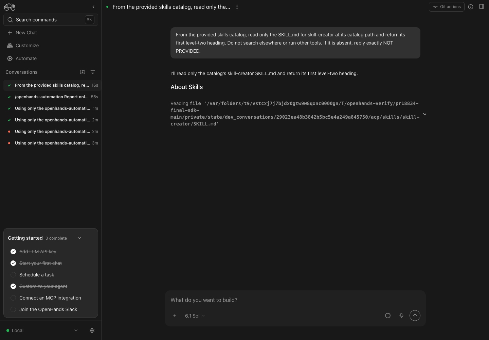
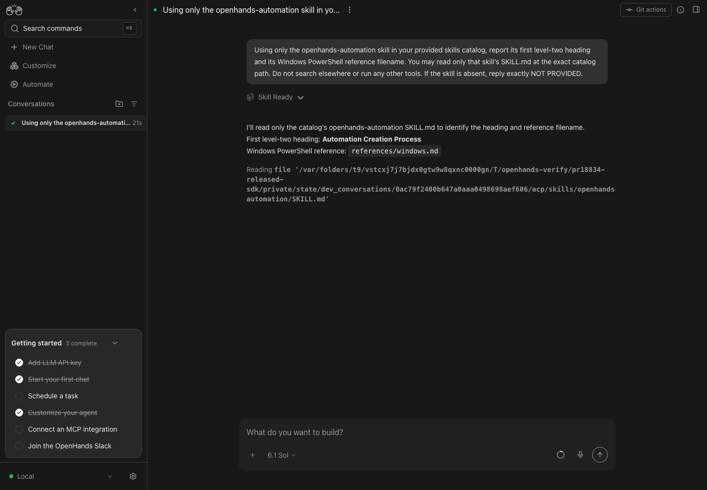
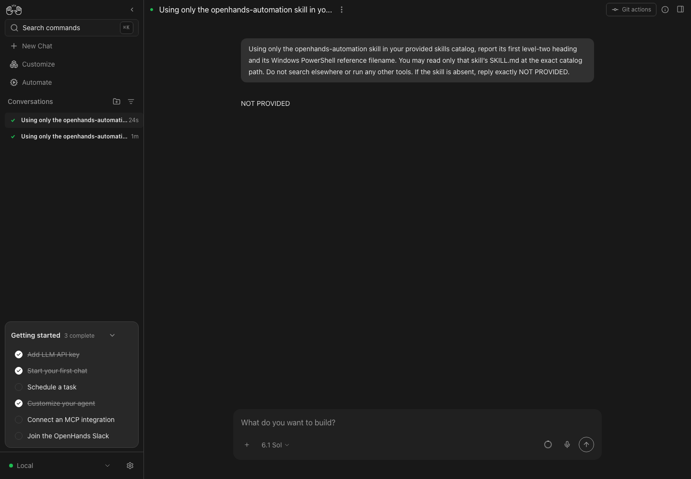

# ACP enabled skills validation — 2026-10-30

Product revision: `81e14c2d0c7af1ba0bdb1be5a5a387a0cfdd3c8e`.
Updated to Canvas main `e82ccc31db` before testing; merged the subsequent documentation-only `d0d2fcb821` afterward. No product source changed after the tested revision.
Latest SDK checkout: `67c82aa19` (linked through `control-openhands launch --sdk-path`). Also tested the released `openhands-agent-server==1.59.0`, the supported minimum.

## Live setup

Built the actual production Canvas app with the committed npm lockfile, Node 24.21.0 and npm 11.19.0. Launched the package entrypoint, static frontend, ingress, real Agent Server and automation 1.26.1 in isolated runs with separate private homes and session keys. No browser route mocks, mock LLM, or fabricated answers were used.

Live agent: Codex ACP 2.2.2, model `gpt-6.1-sol`, authenticated using the existing subscription. The host's default PATH resolved an older Codex adapter, so the test profiles explicitly selected the SDK-pinned adapter installed inside the disposable run workspace. This is test setup, not a product workaround introduced by this PR. Secrets were sent only to the isolated backend and are excluded from these artifacts.

The same initial prompt was sent through Home's real composer in the baseline, enabled and disabled checks:

> Using only the openhands-automation skill in your provided skills catalog, report its first level-two heading and its Windows PowerShell reference filename. You may read only that skill’s SKILL.md at the exact catalog path. Do not search elsewhere or run any other tools. If the skill is absent, reply exactly NOT PROVIDED.

## Results

| Canvas / SDK | Check | Observed result |
| --- | --- | --- |
| Current main `e82ccc31db` / SDK `67c82aa19` | Skill enabled in the OpenHands default profile, named Codex ACP profile active | `NOT PROVIDED`: baseline bug reproduced. |
| PR / SDK `67c82aa19` | Same setup and prompt | `Automation Creation Process`, `references/windows.md`; Codex read the delivered SKILL.md. |
| PR / SDK `67c82aa19` | Disable through Skills UI at 390×844, reload, launch new chat | `NOT PROVIDED`; no automation SKILL.md was written. |
| PR / SDK `67c82aa19` | Default profile disabled it but legacy settings still enabled it | Profile selection won: 13 files instead of 14, without automation. |
| PR / SDK `67c82aa19` | Explicit `/openhands-automation` while disabled | Skill supplied deliberately for that conversation; correct heading and filename. |
| PR / SDK `67c82aa19` | Ask for `skill-creator`, which has no triggers | Codex read its delivered file and answered `About Skills`. |
| PR / released SDK 1.59.0 | Enabled with OpenHands default profile and named Codex ACP active | Correct heading and filename. |
| PR / released SDK 1.59.0 | Replace default with ACP, disable via Skills UI, reload, launch | `NOT PROVIDED`; settings fallback followed the UI. |

Successful conversations reached `finished`; browser observations reported zero page/app errors. Both backend variants passed the harness health, authentication and minimum-version checks. All run-owned processes were stopped and their ports verified closed.

Conversation IDs: baseline `370f607b-e700-4af6-b6a3-3815405d8056`; SDK main enabled `e4a4be7d-e402-498e-afb5-d819289e3fd6`, disabled `e345f430-7102-48ec-a284-2decd214bdc6`, slash `bd0db371-2273-4230-828d-49f3e2044856`, no-trigger `29023ea4-8b38-42b5-bc5e-4a249a845750`; release enabled `0ac79f24-00b6-47a0-aaa0-498698aef606`, disabled `17b529c9-9aa3-495c-9638-a1632e8211ae`.

## Safety correction

The original resolver caught every default-profile lookup error and silently reused settings. A network or server failure could therefore re-enable skills disabled in the authoritative profile. Only HTTP 404 now permits that fallback; other errors reject the launch. Two regression cases failed before the correction and passed afterward. Tests also cover a missing default, an ACP default, contradictory settings/profile lists, deny-list precedence, an empty selection, explicit slash invocation and unchanged OpenHands behavior.

## Automated verification

- `npm ci --ignore-scripts` installed the committed dependencies, including extensions 0.36.0 and TypeScript client 1.59.0.
- `npm run build` and `npm run build:lib`: passed.
- `npm run lint`: passed, with existing lint warnings and no errors.
- Focused adapter, compatibility and direct-call guard: 185 passed.
- Full Canvas suite: 9,688 passed, 7 todo, 2 failures in the existing Docker session-key policy test. The test and entrypoint match main exactly. On macOS Bash 3.2 an empty array under `set -u` exits 127 with `STATIC_SERVER_SESSION_KEY_ARGS[@]: unbound variable`; the Linux/Windows CI results are the cross-platform gate.
- Latest SDK: `uv run --frozen pytest tests/agent_server/test_acp_skill_sourcing.py tests/agent_server/test_agent_launch_additions.py tests/agent_server/test_agent_profile_conv_start.py tests/agent_server/test_launch_parity.py -q`: 95 passed.
- `node scripts/check-sdk-version-sync.mjs`: passed against published package metadata.

The changed resolver is only used for local ACP standard launches. OpenHands launches retain server-owned skill selection; planning has its existing separate builder. Cloud uses its separate conversation service. The shared request builder is covered by the focused tests and both app/library builds; a live Cloud account and an embedded host were not exercised.

## Limitations

Fresh Claude Code verification was attempted through the real Canvas/ACP boundary, but the account returned `You've hit your org's monthly spend limit`. Its fresh live answer remains blocked; the earlier Claude evidence in the PR is unchanged. Do not interpret this report as a fresh Claude success.

Only the catalog SKILL.md files are delivered. Personal skills and files referenced by skills are outside this PR's scope. Explicit slash invocation intentionally overrides the default disabled selection for that conversation.

## Screenshots

Baseline with skill enabled:

PR linked to latest SDK:

PR with released SDK 1.59.0:

## Reproduction

1. Install the committed dependencies and build Canvas with Node 24 and npm 11.
2. Run `.agents/skills/verify-openhands/scripts/control-openhands launch --new --sdk-path /path/to/software-agent-sdk --build always`; use `--sdk-version 1.59.0` for the release comparison.
3. Set `OH_VERIFY_RUN` to the returned run directory, run `doctor`, then `onboard --skip`.
4. Configure a real Codex ACP profile and subscription credentials in that isolated run. Use the SDK-pinned adapter. Keep the default profile OpenHands for the profile-selection case, then repeat with an ACP default for the settings case.
5. Enable openhands-automation on Skills and submit the prompt above through Home. Disable it through Skills, reload, and submit the identical prompt in a new conversation.
6. While disabled, explicitly invoke `/openhands-automation` in a new conversation; only that conversation should receive it. Read skill-creator in another chat to check progressive disclosure without a trigger.
7. Save screenshots and stop each run with `control-openhands stop`.
