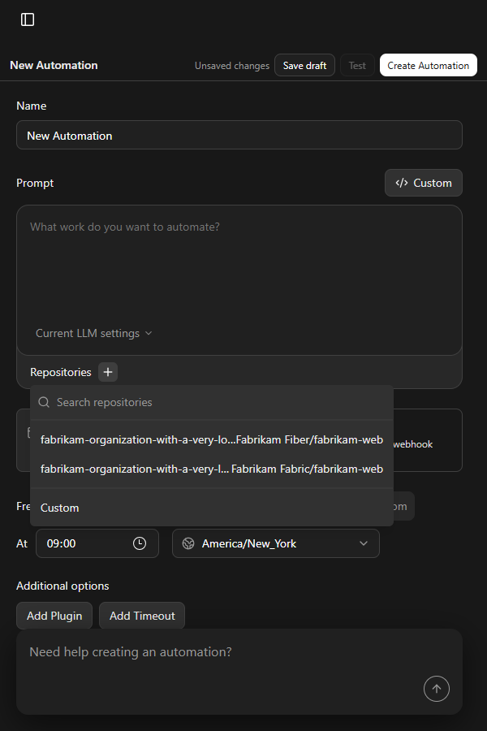

# Repository picker: running Canvas evidence

These screenshots show Agent Canvas at `/automations/setup` in a 600 × 900 Edge viewport. I ran `npm run dev:mock -- --host 127.0.0.1 --port 5199` and supplied the same two temporary mock repository names to both versions of the component:

- `fabrikam-organization-with-a-very-long-shared-prefix-that-fills-the-picker/Fabrikam Fiber/fabrikam-web`
- `fabrikam-organization-with-a-very-long-shared-prefix-that-fills-the-picker/Fabrikam Fabric/fabrikam-web`

The mock fixture was removed after capture and is not part of the PR. The **before** image uses the base version of the component; the **after** images use the PR version.

| Before | After |
| --- | --- |
|  |  |

The full value is available in the [option tooltip](after-tooltip.png) and the [selected repository tooltip](after-selected.png). The selected pill keeps `fabrikam-web` visible.
