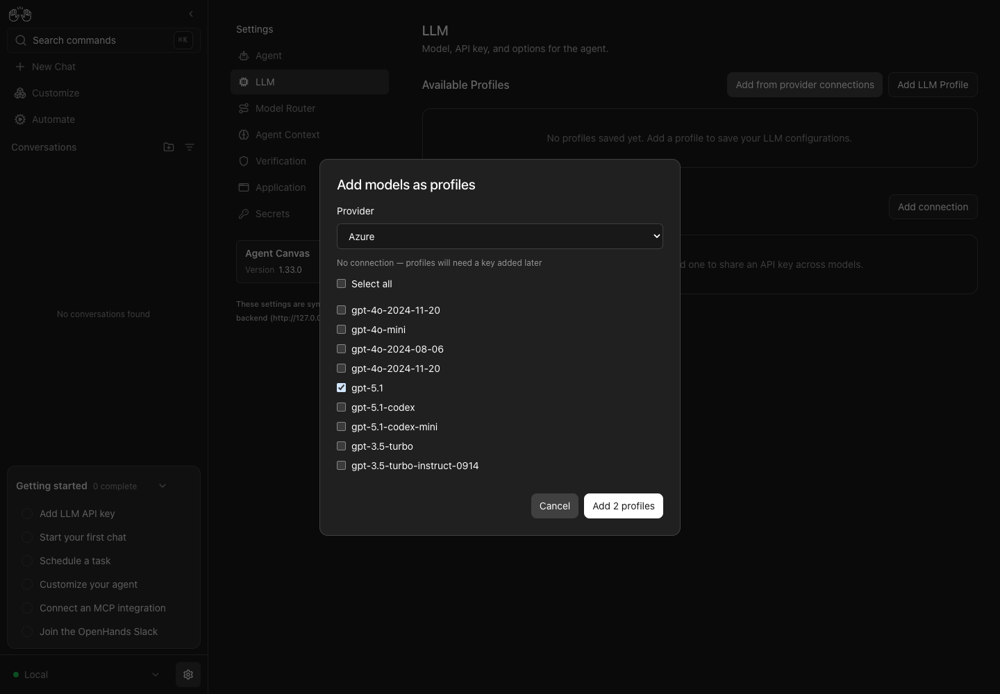
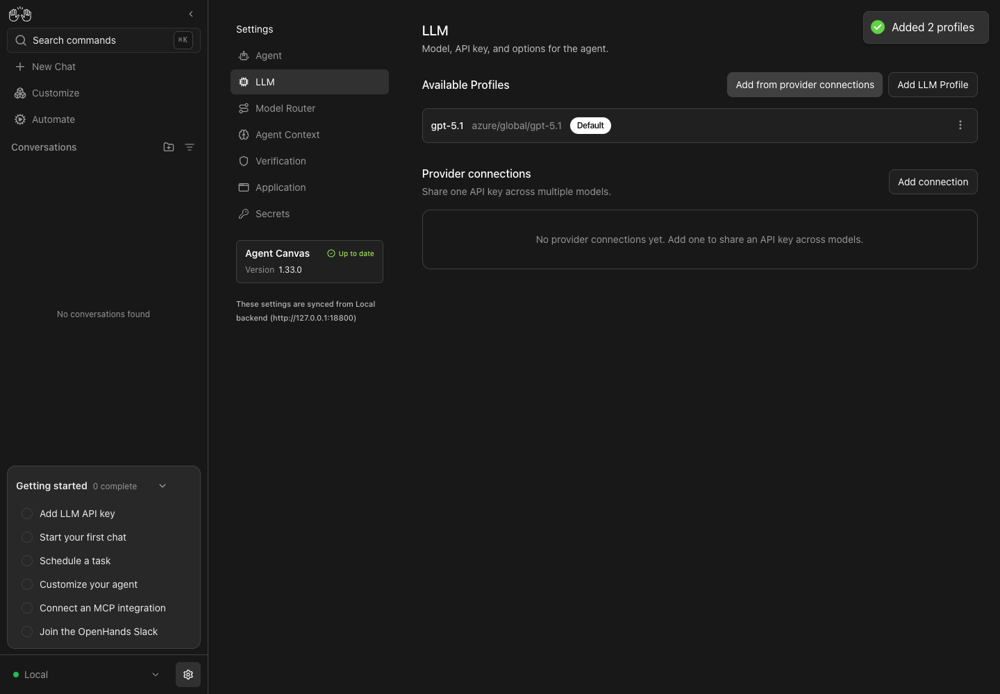
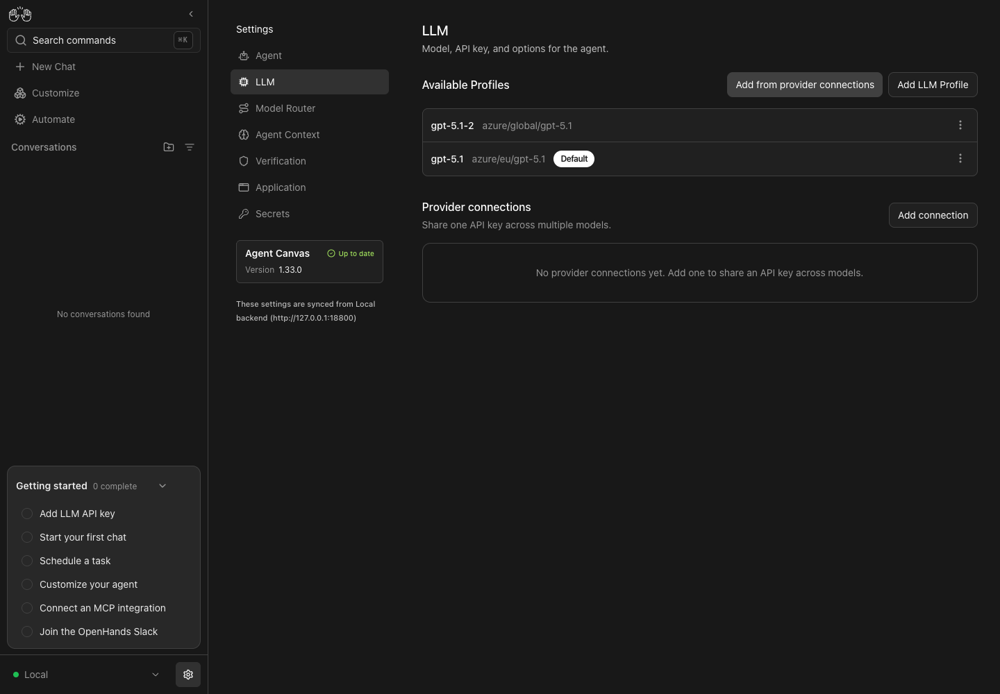

# Bulk model profile name collision

Reproduced on macOS with Agent Canvas 1.33.0, source revision `7a41641c6d8bcf3e2e3c19c08b778781bcf954c2`, Node 24.21.0, real Agent Server 1.58.1, and automation pinned to 1.25.1. No backend responses were mocked, and no model inference or provider credentials were needed for this supported keyless profile-creation path.

## Baseline reproduction

After installing dependencies with `npm ci`, launch the source checkout with the repository verification CLI. It runs `bin/agent-canvas.mjs`, the production launcher used by the npm package, with isolated state and ports.

```sh
export PATH="$PWD/.agents/skills/verify-openhands/scripts:$PATH"
export OH_VERIFY_HOME=/tmp/openhands-qa-bulk
control-openhands launch --new --print-run --run-id qa-model-collision-baseline
```

The run directory was `/tmp/openhands-qa-bulk/qa-model-collision-baseline`. The installed Chrome fallback was used because the pinned Playwright browser was unavailable:

```sh
export CONTROL_OPENHANDS_BROWSER='/Applications/Google Chrome.app/Contents/MacOS/Google Chrome'
export OH_VERIFY_RUN=/tmp/openhands-qa-bulk/qa-model-collision-baseline
control-openhands browser start
control-openhands doctor
control-openhands onboard --skip
control-openhands browser goto /settings/llm
control-openhands api GET /api/profiles
control-openhands browser click testid=add-models-from-provider
control-openhands browser select testid=add-models-provider azure
control-openhands browser check 'testid=add-models-check-azure/eu/gpt-5.1'
control-openhands browser check 'testid=add-models-check-azure/global/gpt-5.1'
control-openhands browser text testid=add-models-submit
control-openhands browser click testid=add-models-submit
control-openhands browser toasts --history
control-openhands api GET /api/profiles
control-openhands stop
```

`doctor` passed. The initial profile list was empty. The submit button read **Add 2 profiles**, and the success toast read **Added 2 profiles**. The resulting list contained only `gpt-5.1`, pointing to `azure/global/gpt-5.1`; the first model had been overwritten.

Both catalog entries are present among the first 100 Azure rows in the real backend catalog. The frontend derives the same profile name from both IDs and saves both through the upsert-by-name API.





The screenshots are unmodified captures from the running Canvas. Only inspected screenshots, recordings, and reproduction notes are published; private run state and browser data are excluded.


## Final fix verification

Product fix commit: `df2ed08`. The live runs used the same source before that commit, build input ID `f097c44ce48d2690-dirty`, with the same real Agent Server 1.58.1 and automation 1.25.1 setup. Node was 24.21.0. The QA shell reported npm 11.19.0 at the end; its baseline npm version was not recorded. Dependency installation and separate verification commands used the repository-pinned npm 11.12.1. The UI runs used the existing locked dependencies and did not resolve or change them.

- Fresh account: selecting the two Azure catalog entries creates `gpt-5.1` for `azure/eu/gpt-5.1` and `gpt-5.1-2` for `azure/global/gpt-5.1`. Both survive reload. Reopening the chooser shows neither configured model.
- Existing profile: with `gpt-5.1` already pointing to `azure/global/gpt-5.1`, the chooser shows the missing EU model and hides the configured global model. Saving EU creates `gpt-5.1-2`, preserving the original global profile. Both survive reload; neither is offered again on reopen.

The second run arranged the valid preexisting state through the real API before exercising the add operation through the UI:

```json
{"llm":{"model":"azure/global/gpt-5.1"},"include_secrets":false}
```

```sh
control-openhands launch --new --print-run --run-id qa-final-existing-global
# Use the printed run directory for every command; save the JSON above to global-profile.json.
control-openhands doctor --run <run>
control-openhands onboard --skip --run <run>
control-openhands api POST /api/profiles/gpt-5.1 --write --data-file <run>/global-profile.json --content-type application/json --run <run>
control-openhands browser goto /settings/llm --run <run>
control-openhands browser click testid=add-models-from-provider --run <run>
control-openhands browser select testid=add-models-provider azure --run <run>
control-openhands browser check 'testid=add-models-check-azure/eu/gpt-5.1' --run <run>
control-openhands browser click testid=add-models-submit --run <run>
control-openhands browser reload --run <run>
control-openhands api GET /api/profiles --run <run>
control-openhands stop --run <run>
```

The fixture POST returned 201. All verification runs were stopped after capture. No model inference was performed; this verifies profile creation and persistence through the real local backend, not inference or a live Cloud deployment.

### Recordings and final state

- [Baseline: two additions overwrite one another](baseline.mp4)
- [Fixed: fresh account](fixed-fresh.mp4)
- [Fixed: existing global profile](fixed-existing.mp4)




### Automated checks

The affected modal and manager suites passed 55 tests. Typecheck, full lint (0 errors; existing warnings), app build, library build, formatting and diff checks passed. The full lint, app-build and library-build commands used npm 11.12.1. Regression coverage includes same-base models, natural suffixes, existing names, the 64-character limit, preexisting model identity, null-model fallback and retained saved-row state after a catalog refresh.
