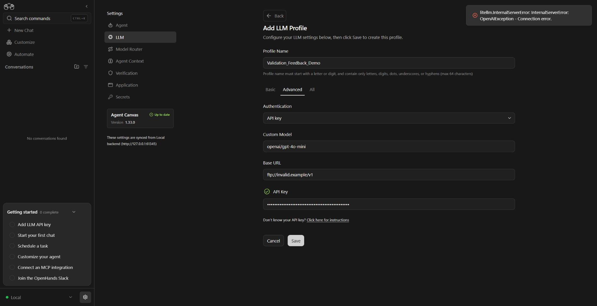
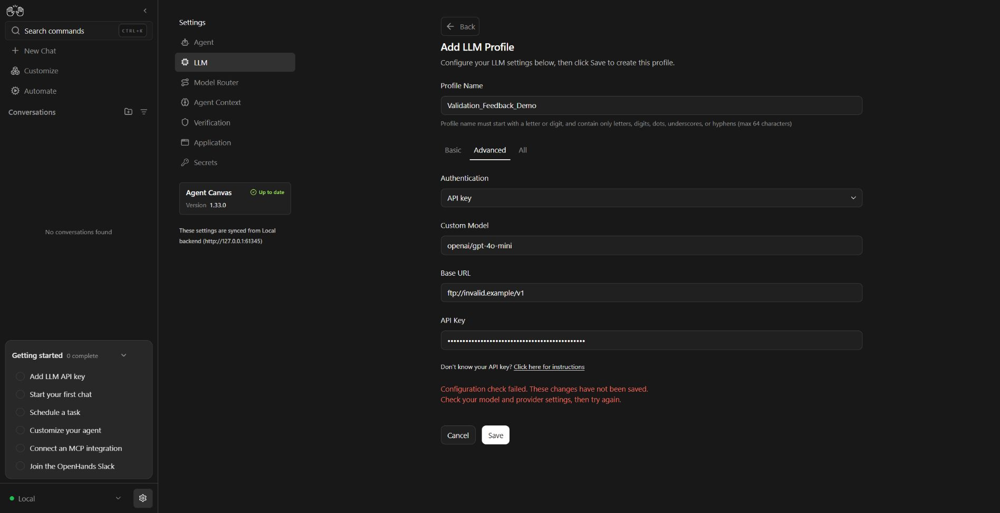
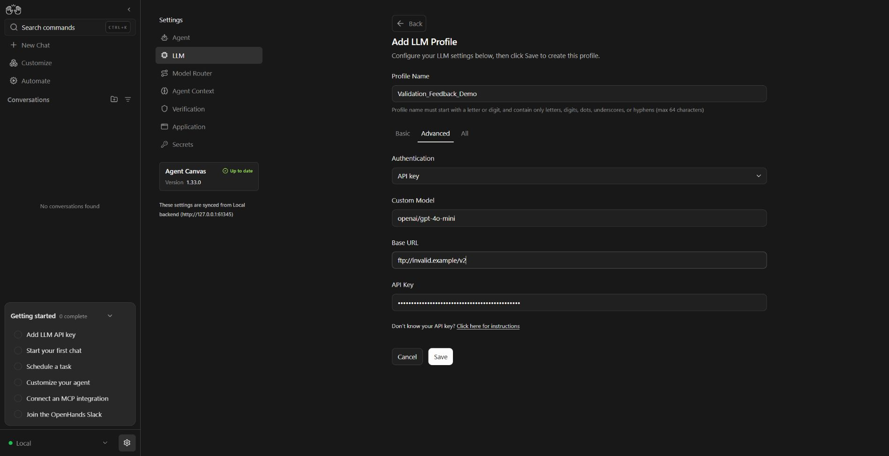
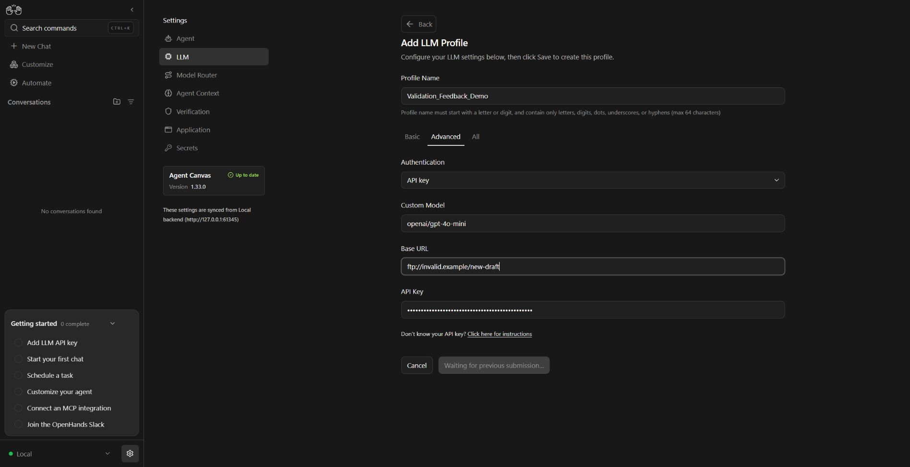
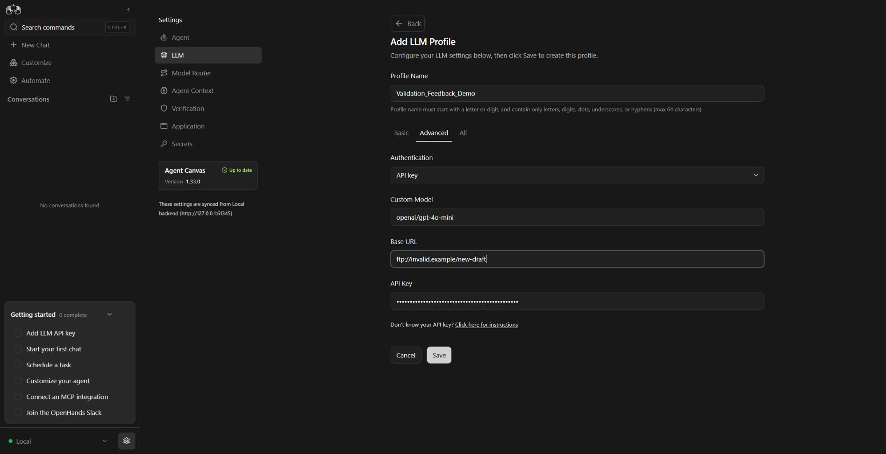

# LLM profile validation feedback

Evidence for the validation-feedback portion of #18727, recorded on 2026-10-26.

## Running application

- Baseline: `b7fdc6c312039a0b840fdcd34a5c23ca7e65c218`.
- Updated UI: the changes in this branch.
- Windows, Node 24.19.0, npm 11.12.1; dependencies installed from the committed lockfile.
- Both UIs used the same unmodified local Agent Server 1.58.1, SDK 1.58.1, tools 1.58.2, and Python 3.13.
- `VITE_MOCK_API=false`; requests reached the running server. Only fabricated provider credentials were used.

Runtime entrypoints used:

```sh
uvx --with openhands-sdk==1.58.1 --from openhands-agent-server==1.58.1 --python 3.13 agent-server --host 127.0.0.1 --port 61345
node node_modules/@react-router/dev/bin.js dev --host 127.0.0.1 --port 65391
node node_modules/@react-router/dev/bin.js dev --host 127.0.0.1 --port 63233
```

The frontend processes ran in separate baseline and updated checkouts. Their backend URL was `http://127.0.0.1:61345`; the isolated server configuration and matching frontend session key were kept outside the repository.

## Reproduction

Open Settings → LLM → Add profile. Select Advanced and fill in:

- Profile: `Validation_Feedback_Demo`
- Model: `openai/gpt-4o-mini`
- Base URL: `ftp://invalid.example/v1`
- API key: a deliberately invalid test value

Select Save. This setup returned HTTP 200 with `valid:false` and `error.type: LLMServiceUnavailableError` from the real validation endpoint.

| Recording | Observed behavior |
| --- | --- |
| [Before, 15.88 s](before.webm) | A nonempty key shows a green check. Save produces a temporary technical error toast; the toast disappears and the check remains. |
| [After, 20.11 s](after.webm) | No key-presence checkmark. The rejected configuration remains visible above the actions. Editing the Base URL clears the feedback. |
| [Late preflight, 36.47 s](late-preflight.webm) | Start one Save using `https://api.openai.com/v1`, then immediately change the URL to `ftp://invalid.example/new-draft`. Save waits for the previous submission. When that submission settles, Save becomes available, the new draft remains open, and no obsolete error appears. |

After the late preflight, `GET /api/profiles` returned `{"profiles":[],"active_profile":null}`.

The recordings retain actual capture intervals, original dimensions, and the full application viewport. Videos begin at their first captured frame; no sections were removed or accelerated. [Timing metadata](timing.json) includes action times and video hashes. Original capture frames remain available locally.

### Key frames











## Verification

| Check | Result |
| --- | --- |
| Five focused test files | 112 passed |
| `npm run lint` | Passed: 0 errors, 508 existing warnings |
| `npm run build` | Exit 0 |
| `npm run build:lib` | Exit 0 |
| `node scripts/check-translation-completeness.cjs` | Passed |
| `npm test -- --maxWorkers=4` | 9,455 passed, 36 failed, 36 skipped, 7 todo |
| Failure comparison | 34 failures reproduced on the unchanged baseline; 2 passed on targeted reruns after restoring omitted sparse-checkout files |

The full suite was not rerun after restoring those files. Existing Windows failures include POSIX assumptions, symlink permissions, and the library output-layout check (`dist/src/index.cjs` versus the expected `dist/index.cjs`). These are outside this change.

The real local rejection covers safe generic feedback for an unrecognized error type. Authentication guidance and the accepted, inconclusive, Cloud, and connection-linked paths also have focused automated coverage; this recording does not demonstrate every provider response. The change preserves the existing save policy and does not certify credentials or implement billing checks.
