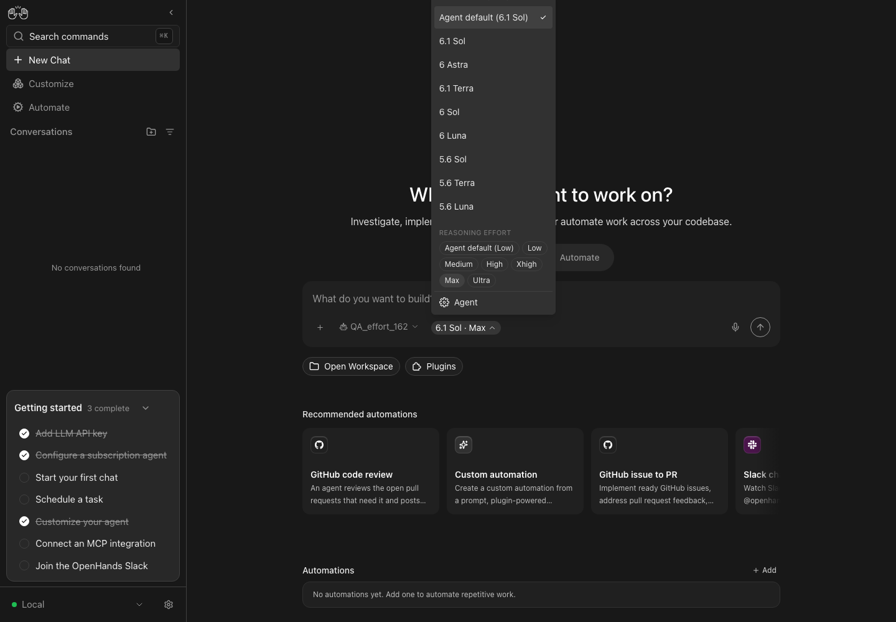
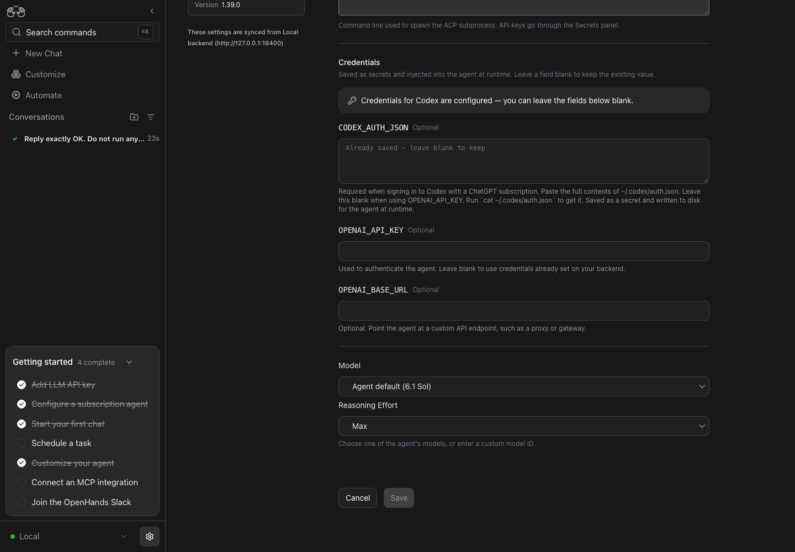
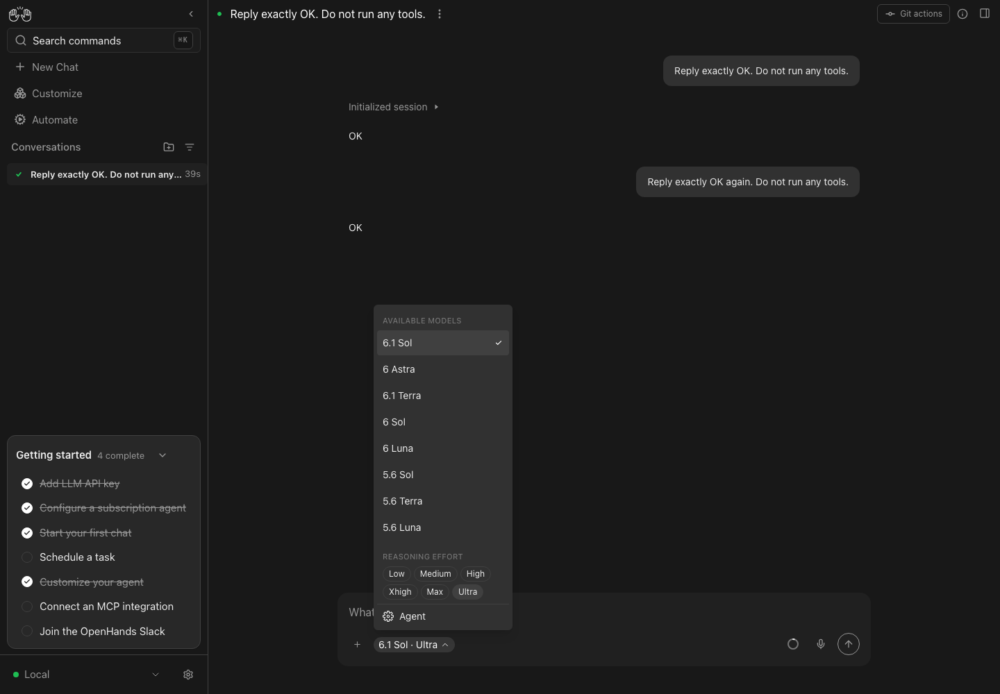

# SDK 1.62.0 validation — 2026-11-12

The branch now includes current Canvas main, including the published `@openhands/typescript-client==1.62.0`, Agent Server 1.62.0 and automation 1.32.1 pins. No local client overlay or SDK source override was used for Canvas validation.

## Automated checks

- Typecheck, lint (warnings only), formatting, standalone app and library builds passed.
- 394 focused ACP/API/state tests passed.
- Full suite: 10,683 passed, 2 failed, 1 skipped and 7 todo. The two failures remain the known `docker-session-key-policy.test.ts` shell-policy tests.
- `node scripts/docker-build.mjs --tag acp-effort-162-canvas:local` built the normal combined image from `ghcr.io/openhands/agent-server:1.62.0-python`. The frontend, Agent Server and automation health routes returned 200; the effort endpoint is present in OpenAPI.
- The verification CLI's isolated native stack passed `doctor` with Agent Server 1.62.0 and no browser errors. The final browser run excludes global ACP binaries from PATH so pinned adapters run.

## Browser checks

Using the real published SDK and pinned Codex ACP 2.2.2: saved Max in the profile editor, reopened it to verify persistence, launched a real conversation at Max, switched to Ultra through the live picker and completed another turn. The live picker has no Agent default action. No browser errors were recorded.

## Live adapter checks

Real subscription logins, SDK installed from the published 1.62.0 wheel, three short turns per provider. These repeat the SDK conversation lifecycle checks; they are separate from browser evidence.

| Provider | Initial effort | Live switch | Invalid level | Model switch |
| --- | --- | --- | --- | --- |
| Codex ACP 2.2.2 | gpt-6.1-sol / max | ultra, same session | rejected before a protocol call | gpt-5.6-luna / medium; ultra no longer offered |
| Claude ACP 0.99.1 | opus[1m] / high | low, same session | rejected before a protocol call | haiku / low; adapter still advertises effort choices |

Codex's rollout `turn_context` records max, ultra and medium for the three turns. Claude completed all three real turns. Unlike the earlier 0.63.0 evidence, 0.99.1 keeps reporting effort choices after switching to Haiku; the UI intentionally follows the adapter's advertised capabilities. This run did not capture new Anthropic request bodies, so it does not establish whether Haiku applies the advertised effort.

Cloud production rollout has not been performed. Enterprise #1270 now includes the required SDK/MCP upgrade and hosted OAuth migration, with profile launch persistence, MCP OAuth/tool-call and proxy regression coverage.
